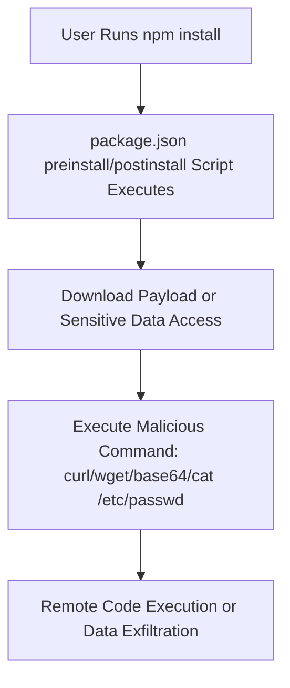

```markdown
# resarch-dataset

# 🛡 NPM Malware Detection Research Notes

## 1️⃣ Hypothesis: Combination of File System and Network APIs Leads to Malicious Attack

### **Detection Criteria**

* **Network Requests**:
  * `http.get`, `axios.get` fetching external payloads.
* **Execution**:
  * `child_process.exec` to run downloaded payloads.
* **File System Modifications**:
  * `fs.chmod` (especially `0777`).
  * `fs.writeFileSync`.
* **Encoded Domains**:
  * `dns.lookup` potentially hiding attacker-controlled endpoints.
* **Obfuscation**:
  * Data flow from decoded/obfuscated strings into dangerous functions.

### **Observed Patterns**

Common malicious chain:

```

http.get → fs.writeFileSync → fs.chmod → child\_process.exec

````

Attackers often:

1. Download payloads.
2. Write them to disk.
3. Make them executable (`chmod 0777`).
4. Execute them.

Seen in:

* Backdoors
* Cryptominers
* Rootkits

### **Refinements**

Enforce detection sequence:

1. **Encoded String Decoded**
2. **Network Request**
3. **Write to File**
4. **Modify Permissions**
5. **Execute File**

Validation:

* Ensure `fs.chmod` targets the same file written by `fs.writeFileSync`.
* Track **execution flow** across these operations.

---

### 📊 Attack Flow Diagram

```mermaid
flowchart TD
    A["Encoded String Decoded"] --> B["Network Request"]
    B --> C["Write to File"]
    C --> D["Modify Permissions (chmod 0777)"]
    D --> E["Execute File"]
````

---

## 2️⃣ Additional Malicious Indicators

### **More Network APIs**

* `fetch`, `net.Socket`, `dns.lookup`

### **Additional Execution Methods**

* `eval`, `Function`, `vm.runInNewContext`

### **Persistence Techniques**

* Modifying `.bashrc`, `crontab`

### **Data Exfiltration**

* Reading `.ssh` keys or environment variables with `fs.readFileSync`

---

## 3️⃣ Hypothesis: OS Fingerprinting + Network API Usage = Potential Malware Activity

### **Detection Criteria**

* **System Info Gathering**:

  * `os.userInfo()`, `os.cpus()`
* **Encoding/Obfuscation**:

  * `btoa`, `Buffer.from`, `encodeURIComponent`
* **Exfiltration**:

  * `fetch`, `http.request`, `https.request`
* **Persistence**:

  * Writing extracted system info to local files.

### **Observed Patterns**

* OS details are collected to **fingerprint victims**.
* Data is encoded before network transmission to **evade detection**.
* Some malware **stores data locally** for delayed exfiltration.

### **Refinements**

* Track encoded system details before reaching network APIs.
* Confirm that data sent in network requests originates from `os.userInfo()` / `os.cpus()`.
* Detect **custom encoding or XOR** functions.
* Expand coverage to persistence storage before exfiltration.

---

### 📊 Attack Flow Diagram

```mermaid
flowchart TD
    A["Collect OS Info: os.userInfo(), os.cpus()"] --> B["Encode/Obfuscate Data"]
    B --> C["Store Locally (optional persistence)"]
    C --> D["Send via Network API: fetch/http.request/https.request"]
```

---

## 4️⃣ Hypothesis: Malicious Pre/Post-Install Scripts in package.json

### **Hypothesis Statement**

Sensitive command-line operations inside `preinstall` or `postinstall` scripts are a strong indicator of malicious behavior.

### **Detection Criteria**

Suspicious commands:

* `curl`, `wget`, `ping`
* `base64`
* `cat /etc/passwd`, `cat /etc/shadow`

### **Attack Rationale**

* These scripts execute automatically during **npm install** lifecycle.
* Used to:

  * Achieve **Remote Code Execution (RCE)**.
  * Exfiltrate sensitive data.
  * Compromise the system.

---

### 📊 Attack Flow Diagram



---

## 📌 Example CodeQL Detection Outline

```ql
/**
 * Detects suspicious sequence:
 *   network request → file write → chmod → execute
 */
import javascript

from CallExpr net, CallExpr write, CallExpr chmod, CallExpr exec
where
  // Network APIs
  net.getCallee().getName() = ["get", "request", "fetch"] and
  net.getArgument(0).getStringValue().regexpMatch("https?://") and

  // File writes
  write.getCallee().getName() = ["writeFileSync", "writeFile"] and

  // Permission changes
  chmod.getCallee().getName() = "chmod" and
  chmod.getArgument(1).getStringValue() = "0777" and

  // Execution
  exec.getCallee().getName() = "exec" and

  // Ensure the chmod and exec operate on the same file
  chmod.getArgument(0) = write.getArgument(0) and
  exec.getArgument(0).contains(chmod.getArgument(0))
select net, "Suspicious download → write → chmod → exec chain detected."
```

---

## 🛠 Tools & Purpose

| Library / Tool           | Purpose                                                         |
| ------------------------ | --------------------------------------------------------------- |
| `pandas`                 | Data analysis & manipulation                                    |
| `matplotlib.pyplot`      | Data visualization & charting                                   |
| `os`                     | Operating system interaction (paths, env vars, file operations) |
| `esprima`                | JavaScript parser for AST-based code analysis                   |
| `networkx`               | Graph creation & analysis (e.g., API call graphs)               |
| `itertools.combinations` | Combinatorics helper for generating API pair combinations       |

```

The npm ecosystem faces increasing supply chain attacks through 
malicious packages. We present a pattern-based detection approach 
using custom CodeQL queries developed from analyzing 56 malicious 
packages.

Training set analysis reveals two key findings: (1) malicious 
packages exhibit 14% lower version-to-version stability than benign 
packages (p = 4.3×10⁻⁹), suggesting evasion through code evolution, 
and (2) malicious packages demonstrate 3.3× higher behavioral 
diversity (p = 1.9×10⁻²⁸), indicating heterogeneous attack strategies.

Evaluation on 95 held-out malicious packages demonstrates 47.4% 
detection rate with 83.3% precision and 3.3% false positive rate 
on 270 benign packages. Our approach substantially outperforms 
existing static analysis tools (ESLint: 0%, Semgrep: 0%) while 
maintaining high precision. Analysis of undetected samples reveals 
novel attack vectors requiring future research on generalized 
detection methods.
## Methodology

### Dataset
We collected malicious packages from Backstabber's Knife Collection 
and npmjs-samples (56 packages, 95 versions total) for training, 
and randomly selected 95 held-out malicious packages (seed=42) from 
npmjs-samples for testing. Benign packages (270) were selected from 
high-download npm packages.

### Query Development
We analyzed training data to identify behavioral patterns and 
developed custom CodeQL queries targeting:
- OS fingerprinting and data exfiltration
- Obfuscated execution patterns
- Malicious install scripts
- Reverse shell indicators
- Computed property access for obfuscation

Queries were finalized before test set evaluation to ensure 
independent assessment.

### Evaluation Metrics
- Pattern Analysis: Jaccard similarity for stability and diversity
- Detection Performance: Precision, Recall, F1-Score, FPR
- Statistical Significance: Mann-Whitney U test (α = 0.05)
## Results

### RQ1: Do malicious packages exhibit distinct behavioral patterns?

**Version Stability Analysis**
Malicious packages show significantly lower version-to-version 
stability (Jaccard = 0.856) compared to benign packages (1.000), 
indicating code modifications across versions (U-test, p = 4.3×10⁻⁹).

**Behavioral Diversity Analysis**
Malicious packages exhibit 3.3× higher inter-package diversity 
(0.837 vs 0.250), demonstrating heterogeneous attack strategies 
rather than common exploit patterns (U-test, p = 1.9×10⁻²⁸).

### RQ2: Can pattern-based queries detect unseen malicious packages?

**Detection Performance**
On 95 held-out packages:
- Detection Rate: 47.4% (45/95)
- Precision: 83.3%
- False Positive Rate: 3.3% (9/270 benign)

**Baseline Comparison**
Our approach outperforms existing tools:
- ESLint Security: 0% detection
- Semgrep: 0% detection (1.9% FPR)
- Proposed CodeQL: 47.4% detection (3.3% FPR)

**Failure Analysis**
The 50 undetected packages employ [analyze and categorize]:
- Novel obfuscation techniques (X packages)
- Different attack vectors (Y packages)
- Minimal malicious code patterns (Z packages)# codeql-ssf-npm-analysis
